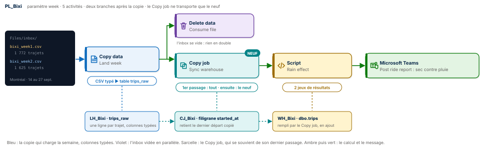
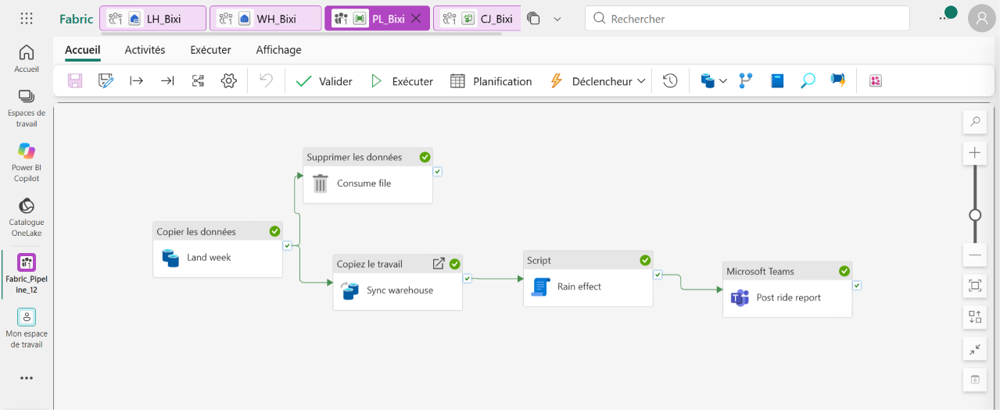
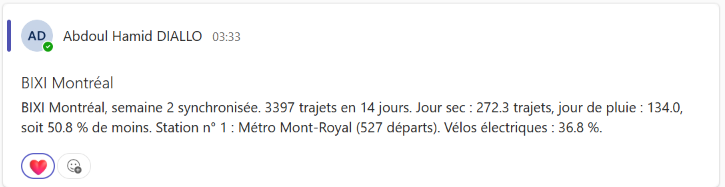
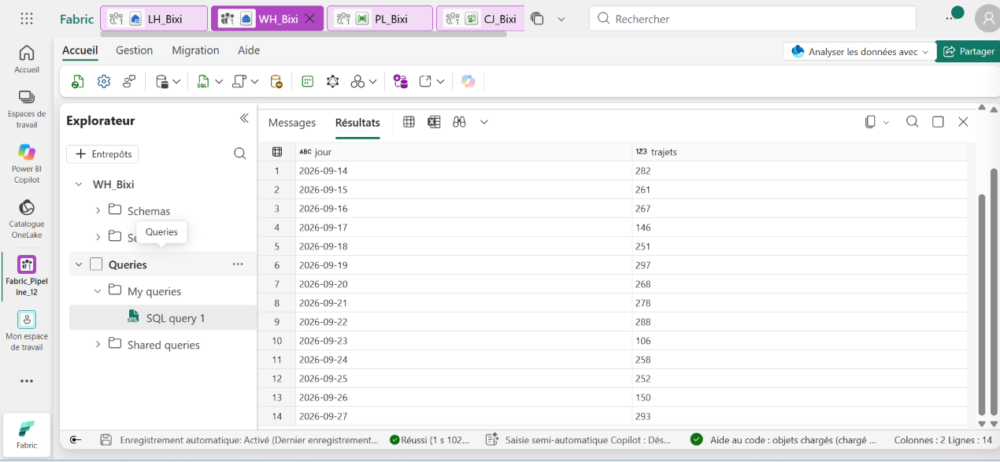
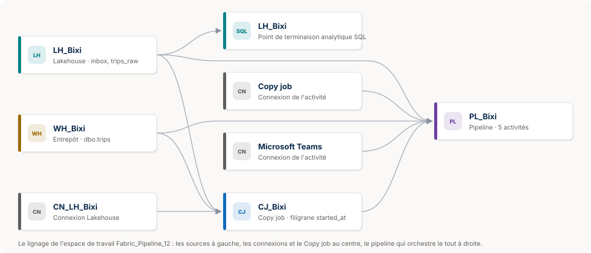

# 🚲 Fabric Pipeline Express 12 : un Copy job qui se souvient




Un pipeline Microsoft Fabric Data Factory qui charge, semaine après semaine, les trajets des vélos BIXI à Montréal. Chaque semaine arrive en un fichier CSV dans une boîte de dépôt. Une copie la charge dans une table aux colonnes typées, la boîte se vide en parallèle, puis un **Copy job incrémentiel** pousse vers l'entrepôt uniquement les trajets qu'il n'a jamais vus. Il retient lui-même où il s'est arrêté : aucune table de contrôle, aucune ligne de code. Un Script mesure enfin ce que la pluie coûte aux vélos, et Teams publie le bilan.

**Guide PDF de 7 pages inclus** : [`Pipeline_Fabric_Guide_12_public.pdf`](Pipeline_Fabric_Guide_12_public.pdf). Chaque écran de l'assistant du Copy job, chaque réglage, chaque expression, et les chiffres à retrouver à l'unité près. Les valeurs à copier sont dans [`data/expressions.txt`](data/expressions.txt) et les requêtes commentées dans [`sql/`](sql).

## 📸 Aperçu

`PL_Bixi` après une exécution réussie : la copie, puis deux branches qui partent ensemble, la suppression du fichier et le Copy job, suivi du Script et de Teams.



Le bilan publié dans Microsoft Teams après la semaine 2, construit à partir des deux résultats du Script.



La requête de contrôle dans l'entrepôt : 14 jours, de 282 trajets le lundi 14 à 293 le dimanche 27, avec les trois creux des jours de pluie.



Le lignage de l'espace de travail : le lakehouse et l'entrepôt, le Copy job `CJ_Bixi`, les connexions, et le pipeline qui les orchestre. Schéma redessiné à partir de la vue Lignage de Fabric ; la capture d'origine est dans [`images/lineage.png`](images/lineage.png).



## 🎯 Résultats clés

| Indicateur | Valeur |
|---|---|
| Activités | 5 (Copy data, Delete data, Copy job, Script, Microsoft Teams) |
| Nouveautés | Élément Copy job, activité Copy job dans un pipeline, filigrane retenu par le Copy job lui-même, colonnes typées dès la copie, deux branches après une même activité |
| Trajets chargés | 3 397 sur 14 jours (1 772 la semaine 1, 1 625 la semaine 2) |
| Lignes lues par le Copy job au 2<sup>e</sup> passage | 1 625 : la semaine 2, rien d'autre |
| Jour sec contre jour de pluie | 272,3 trajets en moyenne contre 134,0 |
| Effet de la pluie | 50,8 % de trajets en moins |
| Station n° 1 | Métro Mont-Royal, 527 départs |
| Vélos électriques | 36,8 % des trajets |

## 💼 Impact métier

Un opérateur de vélos en libre-service reçoit ses données par lots, chaque semaine. Le vrai risque n'est pas de charger, c'est de charger deux fois : une semaine recopiée fausse tous les indicateurs. Ce pipeline règle la question à deux niveaux. Le fichier traité quitte la boîte de dépôt, donc il ne peut plus être relu. Et le Copy job ne transporte que les trajets postérieurs au dernier qu'il a copié. Le résultat, livré dans Teams, est directement utile pour planifier la flotte : un jour de pluie, la demande est divisée par deux. C'est le moment de rééquilibrer les stations ou de lancer la maintenance.

## 📝 Résumé

`PL_Bixi` reçoit un paramètre, `week`, qui construit le nom du fichier : `bixi_week1.csv`, puis `bixi_week2.csv`. La copie `Land week` lit ce CSV dans `Files/inbox` du lakehouse `LH_Bixi` et l'ajoute à la table `trips_raw`. Le mappage donne à chaque colonne son vrai type : `long`, `timestamp`, `integer`. Deux flèches vertes partent alors en même temps. `Consume file` supprime le fichier de l'inbox, et `Sync warehouse` lance le Copy job `CJ_Bixi`. Celui-ci lit `trips_raw` avec `started_at` comme filigrane et écrit dans `WH_Bixi.dbo.trips`. Le Script `Rain effect` compare les jours secs et les jours de pluie, puis `Post ride report` publie le bilan dans Teams.

## 🔁 Pipeline

| Activité | Type | Rôle |
|---|---|---|
| `Land week` | Copy data | `@concat('bixi_week', week, '.csv')` vers la table `trips_raw`, action Ajouter, colonnes typées au mappage |
| `Consume file` | Delete data | En parallèle : supprime le fichier de `inbox`, qui ne pourra jamais être chargé deux fois |
| `Sync warehouse` | Copy job | Lance `CJ_Bixi` : seules les lignes au `started_at` plus récent que le dernier passage rejoignent `dbo.trips` |
| `Rain effect` | Script | `resultSets[0]` : jours secs contre jours de pluie ; `resultSets[1]` : station n° 1 et part des vélos électriques |
| `Post ride report` | Microsoft Teams | Le bilan de la semaine en une ligne |

## 🧠 Les quatre idées du projet

**Un incrémental sans table de contrôle.** D'habitude, il faut une table pour le filigrane, un Lookup pour le lire et un Script pour l'avancer. Le Copy job garde cet état lui-même : il note le plus grand `started_at` copié et, au passage suivant, ne lit que ce qui est plus récent. La preuve est dans les chiffres : 1 772 lignes au premier passage, 1 625 au second.

**Typer dès la copie.** Un CSV ne contient que du texte, et un filigrane n'accepte qu'un nombre ou une date. En réglant les types dans l'onglet Mappage (`trip_id` en `long`, `started_at` en `timestamp`), la table `trips_raw` naît propre, et `started_at` devient un filigrane valide.

**Consommer le fichier.** Copie et suppression partent de la même activité. Le fichier de la semaine quitte l'inbox dès qu'il est chargé : rejouer la semaine 1 s'arrête net sur « fichier introuvable ». C'est voulu, le doublon devient impossible à la source.

**Aucune attente.** Le Copy job écrit directement dans l'entrepôt, et le Script lit `dbo.trips` au même endroit. Pas de point de terminaison SQL à synchroniser, pas d'activité Wait.

## 🚦 Le pipeline en une image

| Étape | Dans un atelier BIXI | Dans Fabric |
|---|---|---|
| 1 | Le relevé de la semaine arrive au courrier | `bixi_week{n}.csv` dans `Files/inbox` |
| 2 | Le commis le recopie au propre dans le registre | Copy data vers `trips_raw`, colonnes typées |
| 3 | Le relevé original part au classement | Delete data, en parallèle |
| 4 | Le comptable reporte seulement les nouvelles lignes | Copy job incrémentiel vers `WH_Bixi` |
| 5 | Le chef d'atelier compare jours secs et jours de pluie | Script à deux résultats |
| 6 | Le tableau du lundi est affiché | Microsoft Teams |

## 🧬 Traçabilité

```
LH_Bixi / Files / inbox / bixi_week{n}.csv          1 772 trajets (semaine 1), 1 625 (semaine 2)
                                    │  Copy data Land week (texte délimité, colonnes typées, Ajouter)
                                    ▼
LH_Bixi.dbo.trips_raw   trip_id long · started_at timestamp · stations · duration_min · ebike
   │                                │
   │  Delete data Consume file      │  Copy job CJ_Bixi, filigrane started_at
   ▼  (l'inbox se vide)             ▼  1er passage : 1 772 lignes · 2e passage : 1 625 lignes
                          WH_Bixi.dbo.trips   3 397 trajets, 14 jours
                                    │  Script Rain effect
                                    ├─ resultSets[0]  trips 3397 · days 14 · dry_avg 272.3 · rain_avg 134.0 · rain_drop_pct 50.8
                                    └─ resultSets[1]  Métro Mont-Royal · 527 départs · ebike_pct 36.8
                                    ▼
                          Microsoft Teams Post ride report
```

## 🏗️ Architecture

| Objet Fabric | Type | Rôle |
|---|---|---|
| `LH_Bixi` | Lakehouse | Reçoit les CSV dans `Files/inbox`, porte la table typée `trips_raw` |
| `CN_LH_Bixi` | Connexion | Permet au Copy job de retenir son filigrane d'un passage à l'autre |
| `CJ_Bixi` | Copy job | Copie incrémentielle de `trips_raw` vers `WH_Bixi.dbo.trips`, filigrane `started_at` |
| `WH_Bixi` | Entrepôt | Porte `dbo.trips` et exécute le Script |
| `PL_Bixi` | Pipeline | Orchestre la copie, la suppression, le Copy job, le calcul et le message |

La première requête du Script, qui mesure l'effet de la pluie :

```sql
WITH t AS (SELECT CAST(LEFT(CAST(started_at AS varchar(30)), 10) AS date) AS d FROM dbo.trips),
w AS (SELECT CAST(d AS date) AS d, rain_mm
      FROM (VALUES ('2026-09-17', 12.4), ('2026-09-23', 8.1), ('2026-09-26', 21.6)) AS v(d, rain_mm)),
j AS (SELECT t.d, COUNT(*) AS n, MAX(CASE WHEN w.d IS NULL THEN 0 ELSE 1 END) AS rainy
      FROM t LEFT JOIN w ON w.d = t.d GROUP BY t.d)
SELECT SUM(n) AS trips, COUNT(*) AS days,
       CAST(AVG(CASE WHEN rainy = 0 THEN n * 1.0 END) AS decimal(6,1)) AS dry_avg,
       CAST(AVG(CASE WHEN rainy = 1 THEN n * 1.0 END) AS decimal(6,1)) AS rain_avg,
       CAST(100 - 100.0 * AVG(CASE WHEN rainy = 1 THEN n * 1.0 END)
                        / AVG(CASE WHEN rainy = 0 THEN n * 1.0 END) AS decimal(4,1)) AS rain_drop_pct
FROM j;
```

La comparaison se fait sur des moyennes par jour, pas sur des totaux : 11 jours secs face à 3 jours de pluie, il faut ramener chaque groupe à une journée type.

## 📊 Résultat final

Les 14 jours, du lundi 14 au dimanche 27 septembre 2026 :

| Semaine | Lun | Mar | Mer | Jeu | Ven | Sam | Dim | Total |
|---|---|---|---|---|---|---|---|---|
| 1 (14 au 20) | 282 | 261 | 267 | **146** 🌧️ | 251 | 297 | 268 | 1 772 |
| 2 (21 au 27) | 278 | 288 | **106** 🌧️ | 258 | 252 | **150** 🌧️ | 293 | 1 625 |

| Mesure | Valeur |
|---|---|
| Moyenne d'un jour sec | 272,3 trajets |
| Moyenne d'un jour de pluie | 134,0 trajets (12,4 mm, 8,1 mm, 21,6 mm) |
| Baisse | **50,8 %** |
| Station n° 1 | Métro Mont-Royal, 527 départs |
| Vélos électriques | 36,8 % |

## 📦 Jeu de données

```
data/
├── bixi_week1.csv     1 772 trajets, du 14 au 20 septembre 2026
├── bixi_week2.csv     1 625 trajets, du 21 au 27 septembre 2026
└── expressions.txt    toutes les valeurs du guide, prêtes à copier
```

Chaque trajet porte `trip_id` (500001 et suivants, jamais réutilisé), `started_at`, `start_station`, `end_station` (dix stations montréalaises, de Métro Mont-Royal au Canal de Lachine), `duration_min` et `ebike` (1 pour un vélo électrique). Données fictives, conçues pour l'exercice et reproductibles avec [`tools/generate_dataset.py`](tools/generate_dataset.py) ; [`tools/expected_results.py`](tools/expected_results.py) recalcule les résultats attendus après chaque exécution.

## 🚀 Reproduire l'exercice

1. Créer un lakehouse `LH_Bixi`, un dossier `Files/inbox`, y déposer les deux CSV. Créer un entrepôt `WH_Bixi`.
2. Créer `PL_Bixi` avec le paramètre `week` = `1`. Copy data `Land week` vers la table `trips_raw` (Ajouter), types réglés au mappage, puis Delete data `Consume file`. Exécuter : 1 772 lignes.
3. Créer le Copy job `CJ_Bixi` : connexion `CN_LH_Bixi`, table `trips_raw`, copie incrémentielle, filigrane `started_at`, destination `WH_Bixi.dbo.trips`. Premier passage : 1 772 lignes.
4. Ajouter l'activité Copy job `Sync warehouse` (seconde flèche verte de `Land week`), le Script `Rain effect` avec [`sql/01_rain_effect.sql`](sql/01_rain_effect.sql), puis Teams.
5. Exécuter avec `week` = `2` : le Copy job lit 1 625 lignes, l'entrepôt compte 3 397 trajets, Teams publie le bilan.

## 📂 Structure du dépôt

```
fabric-pipeline-express-12/
├── README.md
├── Pipeline_Fabric_Guide_12_public.pdf    le guide de 7 pages
├── data/
│   ├── bixi_week1.csv, bixi_week2.csv     les deux semaines de trajets
│   └── expressions.txt                    toutes les valeurs à copier
├── sql/
│   ├── 01_rain_effect.sql                 les deux requêtes du Script
│   └── 02_controle.sql                    trajets par jour dans l'entrepôt
├── tools/
│   ├── generate_dataset.py                régénère les deux CSV
│   └── expected_results.py                recalcule les résultats attendus
└── images/
    ├── pipeline_diagram.svg               le schéma du pipeline
    ├── pipeline_run.png                   PL_Bixi après une exécution réussie
    ├── teams_message.png                  le bilan dans Microsoft Teams
    ├── controle_sql.png                   la requête de contrôle, 14 jours
    ├── lineage.svg                        le lignage de l'espace de travail, redessiné
    └── lineage.png                        la capture d'origine du lignage
```

## 🧰 Stack technique

Microsoft Fabric Data Factory · Copy job incrémentiel · Activité Copy job · Copy data et mappage typé · Delete data · Expressions `@concat` · Script à plusieurs résultats · Warehouse et T-SQL · Lakehouse et Delta · Microsoft Teams

## ✅ Conclusion

La donnée arrive par lots, et le pipeline garantit qu'aucun lot n'est compté deux fois : le fichier traité sort de la boîte de dépôt, et le Copy job ne transporte que ce qu'il n'a jamais vu. Cinq activités, aucune table de contrôle, aucun code Spark, et une réponse claire au bout : à Montréal, un jour de pluie coûte la moitié des trajets.

## 💭 Dernier mot

Un bon pipeline ne se contente pas de déplacer les données. Il se souvient de ce qu'il a déjà fait.

---

Abdoul Hamid Diallo · Microsoft Data & AI Engineer · Microsoft Certified DP-600, DP-700, PL-300, AI-102, DP-100, AI-900, DP-900 · [LinkedIn](https://www.linkedin.com/in/abdoul-hamid-diallo-fabric-data-engineer/)
